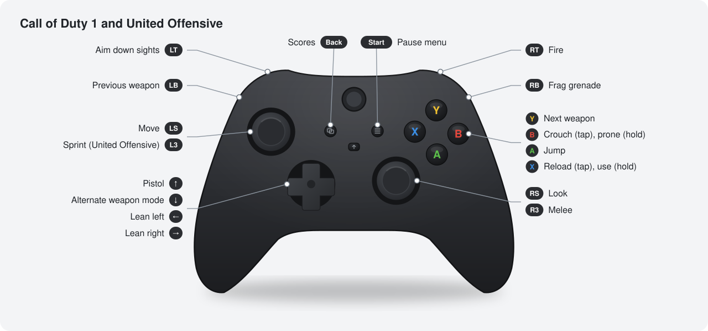
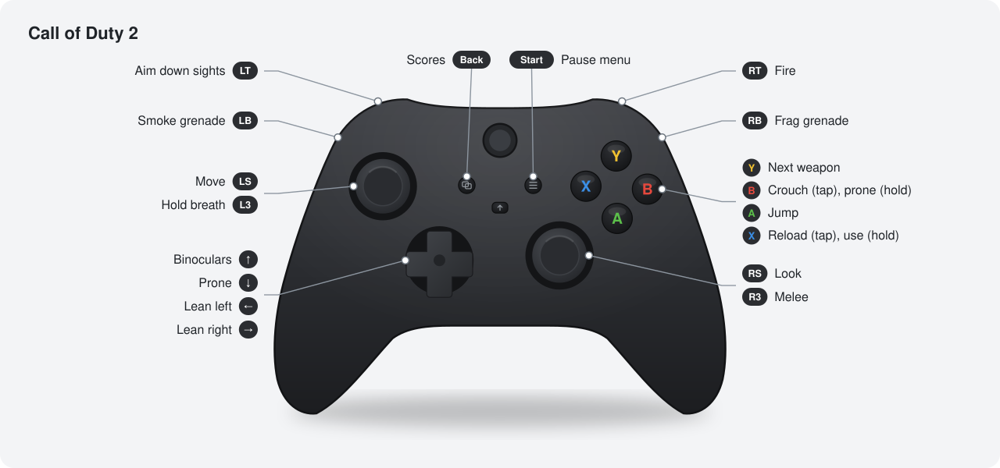
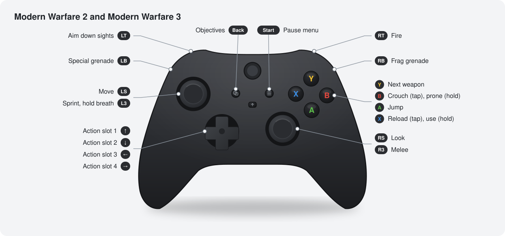

# IW-Pad

IW-Pad adds controller support and console aim assist to the single-player campaigns of
Call of Duty 1, Call of Duty 1: United Offensive, Call of Duty 2, Modern Warfare 2 and Modern Warfare 3.
It works on Windows and on Linux with Proton. It was made for the Steam Deck.

## Supported games

| Game | Version |
|---|---|
| Call of Duty 1 (2003) | 1.1 and 1.5 (Steam) |
| Call of Duty 1: United Offensive (2004) | 1.41 (Steam) |
| Call of Duty 2 (2005) | 1.3 (Steam) |
| Modern Warfare 2 (2009) | 64-bit and 32-bit (32-bit needs AlterWare iw4x-sp) |
| Modern Warfare 3 (2011) | 64-bit and 32-bit (32-bit needs AlterWare iw5-mod) |

IW-Pad works only with these versions.

> [!WARNING]
> The 64-bit MW2 and MW3 still have remote code execution (RCE) bugs in single player and Special Ops.
> IW-Pad does not fix them. Play offline.

## Install

### With DeckOps

[DeckOps](https://github.com/GalvarinoDev/DeckOps) installs and updates IW-Pad for you.

### Manual

1. Download `iw-pad.zip` from the latest release.
2. Extract `iw-pad.exe`, `iw-pad.dll` and `iw-pad32.dll` into the game folder, next to the game exe.
3. Call of Duty 1, Call of Duty 1: United Offensive and Call of Duty 2 only. Copy the menu file from the `classic` folder:

   | Game | File | Copy to |
   |---|---|---|
   | Call of Duty 1 | `z_iwpad.pk3` | `main/` (Steam: `Main/`) |
   | Call of Duty 1: United Offensive | `zz_iwpad.pk3` | `uo/` |
   | Call of Duty 2 | `zz_iwpad.iwd` | `main/` |

4. On Windows, start `iw-pad.exe`. On Linux, set the Steam launch option:

   | Game | Launch option |
   |---|---|
   | Call of Duty 1 | `MESA_EXTENSION_MAX_YEAR=2003 bash -c 'exec "${@/CoDSP.exe/iw-pad.exe}"' -- %command%` |
   | Call of Duty 1: United Offensive | `MESA_EXTENSION_MAX_YEAR=2003 bash -c 'exec "${@/CoDUOSP.exe/iw-pad.exe}"' -- %command%` |
   | Call of Duty 2 | `bash -c 'exec "${@/CoD2SP_s.exe/iw-pad.exe}"' -- %command%` |
   | MW2 | `bash -c 'exec "${@/iw4sp.exe/iw-pad.exe}"' -- %command%` |
   | MW3 | `bash -c 'exec "${@/iw5sp.exe/iw-pad.exe}"' -- %command%` |

5. In Steam Input, use a gamepad layout, not a keyboard and mouse layout.

On Steam, Call of Duty 1 and Call of Duty 1: United Offensive share one game folder. Copy the files there once.

For 32-bit MW2 and MW3, put AlterWare `iw4x-sp.exe` or `iw5-mod.exe` in the game folder too. The launcher starts it.

If you start the game without `iw-pad.exe`, the game runs unmodified.

## Controls

The binds are set once, when no controller button has a bind. You can change them in the game console.
Controller settings are in **Options > Controls > Look**.

Text version

**Call of Duty 1, Call of Duty 1: United Offensive and Call of Duty 2**

| Button | Call of Duty 1 and Call of Duty 1: United Offensive | Call of Duty 2 |
|---|---|---|
| A | Jump | Jump |
| B | Crouch (tap), prone (hold) | Crouch (tap), prone (hold) |
| X | Reload (tap), use (hold) | Reload (tap), use (hold) |
| Y | Next weapon | Next weapon |
| LB | Previous weapon | Smoke grenade |
| RB | Frag grenade | Frag grenade |
| LT | Aim down sights | Aim down sights |
| RT | Fire | Fire |
| L3 | Sprint (Call of Duty 1: United Offensive only) | Hold breath |
| R3 | Melee | Melee |
| D-pad up | Pistol | Binoculars |
| D-pad down | Alternate weapon mode | Prone |
| D-pad left and right | Lean | Lean |
| Back | Scores | Scores |
| Start | Pause menu | Pause menu |

**MW2 and MW3**

| Button | Action |
|---|---|
| A | Jump |
| B | Crouch (tap), prone (hold) |
| X | Reload (tap), use (hold) |
| Y | Next weapon |
| LB | Special grenade |
| RB | Frag grenade |
| LT | Aim down sights |
| RT | Fire |
| L3 | Sprint, hold breath |
| R3 | Melee |
| D-pad | Action slots 1 to 4 |
| Back | Objectives |
| Start | Pause menu |

## Problems

IW-Pad writes `iw-pad.log` in the game folder. If it says `unsupported game build`, IW-Pad does not know your
game version. Open an issue and attach the log.

Settings, build steps and technical details are in [DETAILS.md](DETAILS.md).

## Credits

- [IW4x](https://github.com/iw4x/iw4x-client): aim assist logic ported from `Controller/Engine/View.cpp`.
- [iw3sp_mod](https://gitea.com/JerryALT/iw3sp_mod): controller and aim assist logic ported from `Gamepad.cpp`.
- [AlterWare](https://alterware.dev): iw4x-sp (MW2) and iw5-mod (MW3). The iw4x-sp symbols helped find the game addresses.
- [llvm-mingw](https://github.com/mstorsjo/llvm-mingw), [Ghidra](https://ghidra-sre.org) and [Capstone](https://www.capstone-engine.org): build and analysis tools.

## License

GPL-3.0. See `LICENSE`. IW-Pad is not related to Activision or Infinity Ward. You must own the game.
